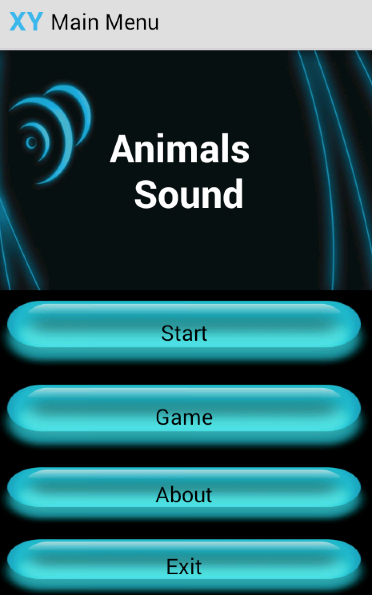
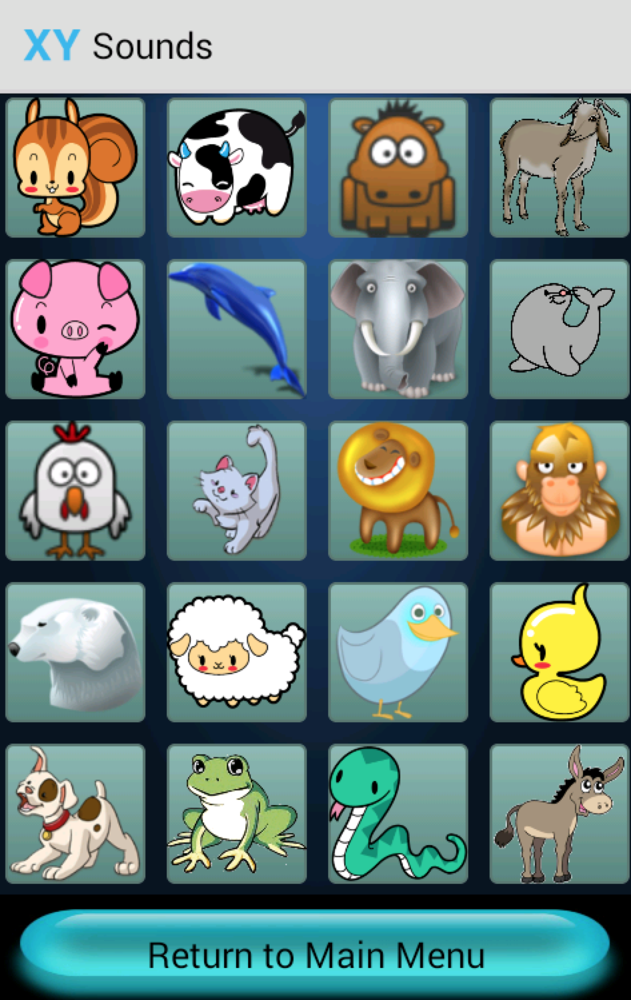
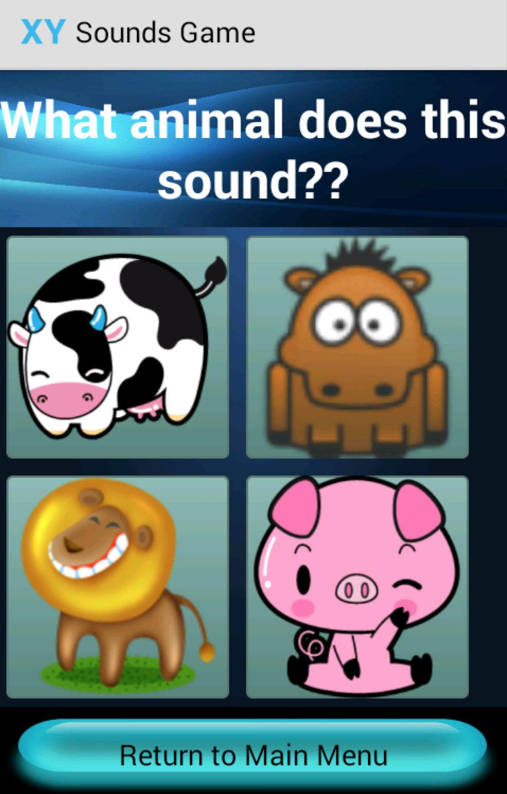

# 🐾 Animal Sounds (Sonidos de Animales)

> **Primer juego interactivo táctil para Android desarrollado desde cero.**  
> *Lanzado originalmente en febrero de 2015.*

[-green?style=flat-square&logo=android)](https://github.com/JoseMHR/TaosLegacyGames/tree/main/animal-sounds)

---

## 📖 Contexto e Historia

**Animal Sounds** fue mi proyecto de iniciación en el desarrollo móvil nativo en Java. La meta principal era dominar el ciclo de vida de las *Activities* de Android, la gestión de recursos multimedia (audio y efectos con `MediaPlayer` / `SoundPool`) y la construcción de interfaces táctiles reactivas pensadas para los más pequeños.

El juego llegó a publicarse en Google Play Store en 2015 bajo el paquete `taos.sonidosanimalesfree.proyecto`.

---

## 🎮 Mecánicas y Características

* **Catálogo de Animales**: Galería con ilustraciones representativas (león, perro, delfín, elefante, etc.).
* **Pulsador Sonoro**: Al tocar cualquier animal, reproduce su sonido característico con feedback visual instantáneo.
* **Interfaz Adaptable**: Diseñado para funcionar en teléfonos y tabletas Android de la época (pantallas WVGA hasta 1080p).
* **Menú Principal**: Navegación sencilla entre categorías y créditos.

---

## 📸 Galería de Capturas (2015)

  
  
  

---

## 🛠️ Retrospectiva Técnica

* **Herramientas de la época**: Programado en **Eclipse IDE con el plugin ADT** (Android Development Tools), antes del estándar de Android Studio y Gradle.
* **Lecciones aprendidas**: Gestión eficiente de memoria con bitmaps para evitar los temidos `OutOfMemoryError` de Android KitKat (4.4), liberación controlada de streams de audio y estructuración limpia de layouts en XML.

---

## 📦 Ejecutables y Código Fuente

* **APK Histórico**: [`./Apks Demo/AnimalSounds.apk`](./Apks%20Demo/AnimalSounds.apk)
* **Código Fuente**: [`./AnimalSound Source Code/`](./AnimalSound%20Source%20Code/)

---

[← Volver al Archivo Principal (TaosLegacyGames)](../README.md)
