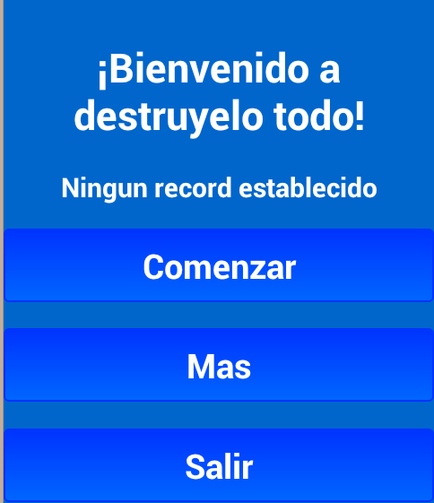
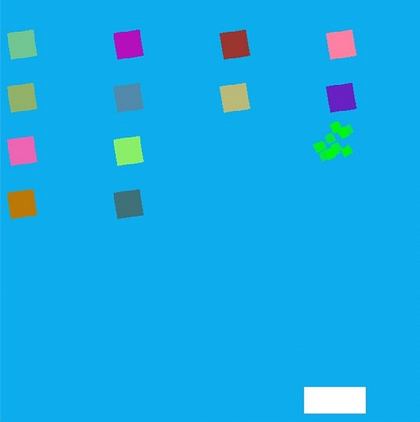
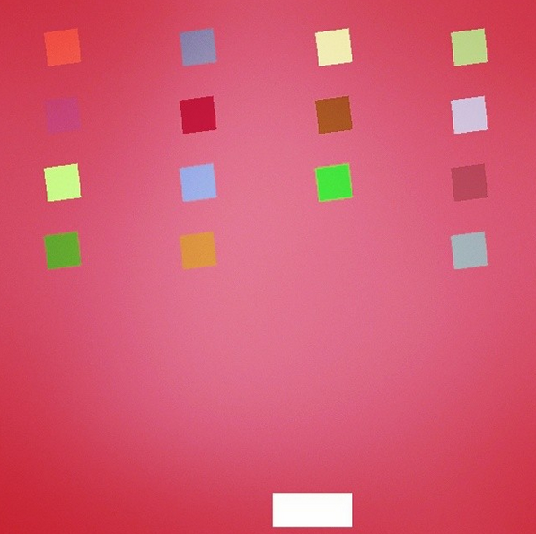

# 💥 Destroy-All (¡Destrúyelo Todo!)

> **Arcade 2D de destrucción táctil con AndEngine GLES2 para Android.**  
> *Lanzado originalmente en febrero de 2015.*

---

## 📖 Contexto e Historia

**Destroy-All** supuso mi primera incursión en un **motor de videojuegos real para móviles**: **AndEngine** (un framework open source de renderizado 2D acelerado por hardware con OpenGL ES 2.0 muy popular en la era dorada de Android).

El objetivo fue aprender a gestionar el bucle de juego (*Game Loop*), el ciclo de actualización/renderizado por frames (`onUpdate`), la carga de texturas con `TextureAtlas`, y la respuesta a eventos multitáctiles rápidos.

Llegó a publicarse en Google Play Store bajo el paquete `taos.destroy.all`.

---

## 🎮 Mecánicas de Juego

* **Destrucción por Toque**: Oleadas de elementos dinámicos caen o aparecen en pantalla y deben destruirse antes de que escapen.
* **Sistema de Puntuaciones**: Registro del mejor récord establecido y contador en tiempo real.
* **Físicas y Partículas**: Uso de efectos visuales al destruir objetivos con animaciones de explosión y fuentes bitmap personalizadas (`.fnt`).

---

## 📸 Galería de Capturas (2015)

  
  
  

---

## 🛠️ Retrospectiva Técnica

* **Motor**: **AndEngine GLES2** con arquitectura de escenas (`SceneManager`, `SplashScene`, `GameScene`).
* **Gráficos**: Uso de fuentes de mapa de bits (`BitmapFont.fnt`) y spritesheets empaquetados para minimizar las llamadas de dibujado (*draw calls*) en GPU.
* **Lecciones aprendidas**: Entendimiento profundo del renderizado en OpenGL ES en dispositivos móviles con recursos limitados.

---

## 📦 Ejecutables y Código Fuente

* **APK Histórico**: [`./Apks Demo/DestruyeTodo.apk`](./Apks%20Demo/DestruyeTodo.apk)
* **Código Fuente**: [`./Destroy-All Source Code/`](./Destroy-All%20Source%20Code/)

---

[← Volver al Archivo Principal (TaosLegacyGames)](../README.md)
