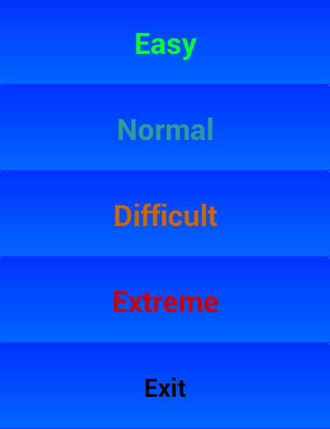
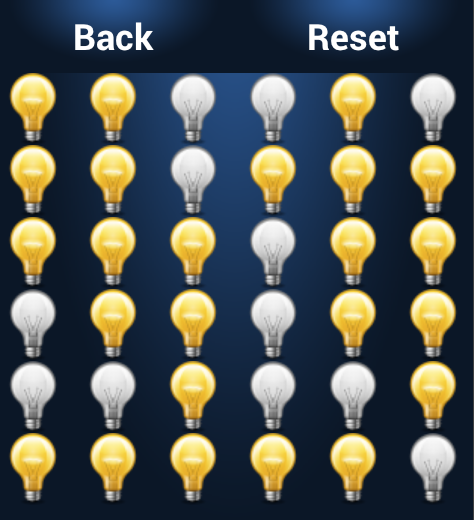
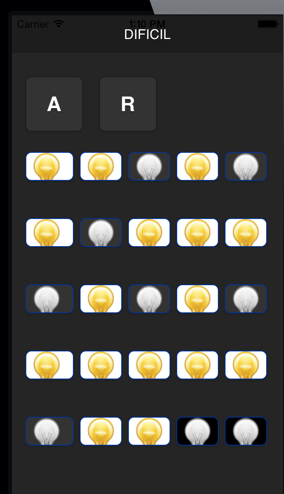

# 💡 Lights Out (Luces Fuera)

> **Adaptación clásica del mítico rompecabezas de lógica matricial.**  
> *Lanzado originalmente en febrero de 2015.*

---

## 📖 Contexto e Historia

**Lights Out** fue mi segundo desarrollo completo para Android. Inspirado en el clásico rompecabezas electrónico de Tiger Electronics de los años 90, el desafío consistía en implementar la lógica matemática subyacente del juego: al pulsar una celda, tanto ella como sus vecinas ortogonales (arriba, abajo, izquierda y derecha) cambian de estado (encendido/apagado).

El objetivo es apagar todas las luces de la cuadrícula en el menor número de movimientos posible.

Llegó a estar publicado en Google Play Store bajo el paquete `com.lucesfuera.taos`.

---

## 🎮 Características

* **Modos de Dificultad**: Niveles escalonados (Fácil, Normal, Difícil) con tamaños de tablero y patrones iniciales variados.
* **Soporte Bilingüe Completo**: Menús y textos configurados tanto en **Español** como en **Inglés**.
* **Contador de Movimientos y Temporizador**: Reto contra uno mismo para optimizar cada paso.
* **Diseño Minimalista**: Centrado puramente en la resolución del puzzle.

---

## 📸 Galería de Capturas (2015)

  
  
  

---

## 🛠️ Retrospectiva Técnica

* **Algoritmo**: Manipulación de matrices bidimensionales y álgebra booleana en Java.
* **UI**: Construido con un `GridLayout` dinámico con botones personalizados y estados gráficos (`selector` XML) para representar celdas activas e inactivas.

---

## 📦 Ejecutables y Código Fuente

* **APK Histórico**: [`./Apk Demo/LightOut.apk`](./Apk%20Demo/LightOut.apk)
* **Código Fuente**: [`./Light Out Source Code/`](./Light%20Out%20Source%20Code/)

---

[← Volver al Archivo Principal (TaosLegacyGames)](../README.md)
