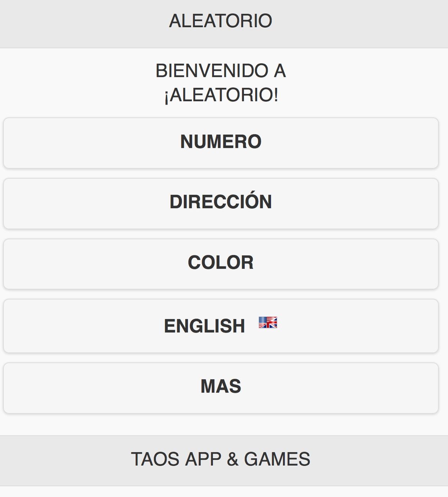
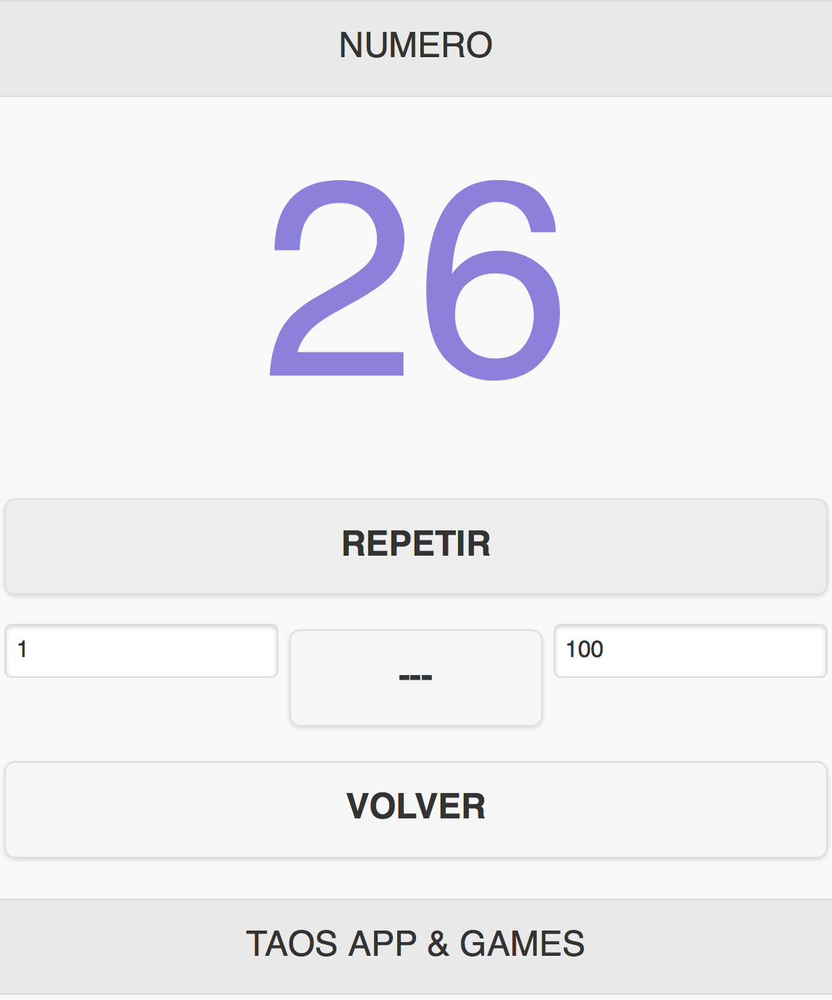
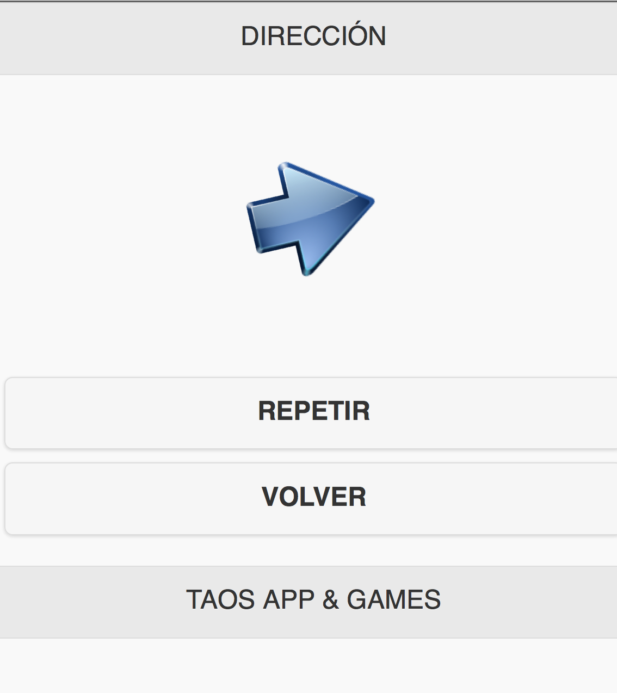

# 🎲 Random (Juegos Aleatorios)

> **Juego experimental híbrido móvil desarrollado con Apache Cordova / PhoneGap.**  
> *Lanzado originalmente en febrero de 2015.*

---

## 📖 Contexto e Historia

**Random** nació como una investigación técnica sobre el **desarrollo móvil híbrido** en 2015, evaluando si las tecnologías web (*HTML5, CSS3 y JavaScript*) podían competir con el código nativo de Android empaquetándose mediante **Apache Cordova / PhoneGap**.

El proyecto explora dinámicas de azar, dados, selección aleatoria y minijuegos rápidos con interfaz táctil fluida.

Llegó a estar publicado en Google Play Store bajo el paquete `com.aleatorio.taos`.

---

## 🎮 Mecánicas

* **Generador y Ruleta Aleatoria**: Selección aleatoria visual para toma de decisiones y retos entre amigos.
* **Minijuegos de Suerte**: Dinámicas de dados, monedas y números aleatorios.
* **Interfaz Responsive Webview**: Diseñado para adaptarse de forma fluida a cualquier resolución móvil.

---

## 📸 Galería de Capturas (2015)

  
  
  

---

## 🛠️ Retrospectiva Técnica

* **Stack**: HTML5, CSS3, JavaScript puro (sin frameworks pesados) empaquetado dentro de un contenedor Cordova `WebView`.
* **Conclusiones de la época**: Aunque el desarrollo fue mucho más rápido que en Java nativo, las limitaciones de rendimiento de los navegadores móviles de 2015 demostraron que para videojuegos complejos el código nativo o un motor dedicado (como AndEngine o Unity) eran indispensables.

---

## 📦 Ejecutables y Código Fuente

* **APK Histórico**: [`./Apk Demo/aleatorio.apk`](./Apk%20Demo/aleatorio.apk)
* **Código Fuente**: [`./Random Source Code/`](./Random%20Source%20Code/)

---

[← Volver al Archivo Principal (TaosLegacyGames)](../README.md)
