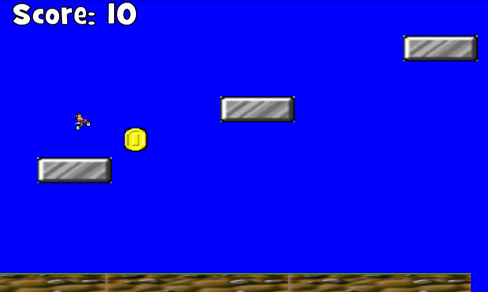
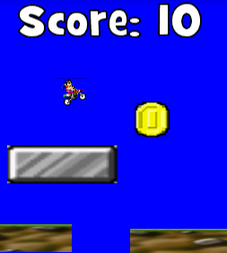
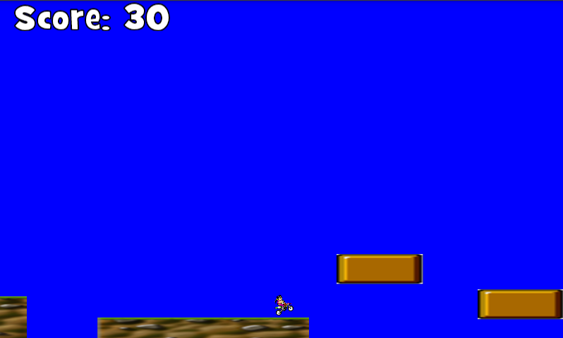

# 🏃 Run-Or-Die (Corre o Muere)

> **Endless runner 2D de reflejos y saltos desarrollado con AndEngine GLES2.**  
> *Lanzado originalmente en febrero de 2015.*

---

## 📖 Contexto e Historia

**Run-Or-Die** fue mi segundo desarrollo en **AndEngine**, consolidando conceptos más avanzados de gamedev:
* **Parallax Scrolling**: Fondos con varias capas desplazándose a distintas velocidades para generar profundidad visual.
* **Detección de Colisiones**: Hitboxes precisas entre el personaje y los obstáculos.
* **Curva de Dificultad Dinámica**: Aceleración progresiva de la velocidad del mundo conforme el jugador sobrevive.

Llegó a estar publicado en Google Play Store bajo el paquete `taos.runordie.game`.

---

## 🎮 Mecánicas de Juego

* **Control a un Solo Toque**: Toca la pantalla para saltar obstáculos y pozos.
* **Físicas de Gravedad y Salto**: Cálculo parabólico de salto y caída con aceleración.
* **Scroll Infinito Progresivo**: Generación procedural de obstáculos en el borde derecho de la pantalla.
* **Récord de Distancia**: Competición personal por recorrer la mayor cantidad de metros.

---

## 📸 Galería de Capturas (2015)

  
  
  

---

## 🛠️ Retrospectiva Técnica

* **Motor**: **AndEngine GLES2 Anchor Center**.
* **Gestión de Entidades**: Creación y reciclaje de objetos (*Object Pooling*) para evitar la recolección de basura (*Garbage Collector*) durante la partida, garantizando 60 FPS estables en móviles de 2015.

---

## 📦 Ejecutables y Código Fuente

* **APK Histórico**: [`./Apk Demo/RunOrDie.apk`](./Apk%20Demo/RunOrDie.apk)
* **Código Fuente**: [`./Run or Die Source Code/`](./Run%20or%20Die%20Source%20Code/)

---

[← Volver al Archivo Principal (TaosLegacyGames)](../README.md)
